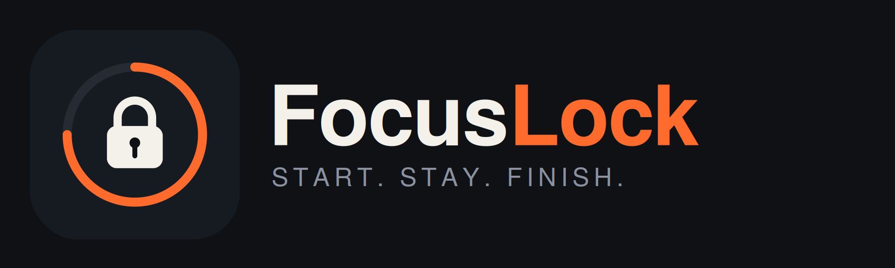

<p align="center">
  
</p>

<p align="center"><b>Start. Stay. Finish.</b></p>

# FocusLock

FocusLock is a Flutter productivity app that helps you actually finish what you plan to do. You schedule a task with a start time, a focus duration and an optional deadline. When it is time, the app notifies you, locks you into a focus session with distracting apps blocked, and only lets you out once you prove the task is done.

Built for the University of Mindanao IT Professional Track 5 project requirement (IT14/L).

## Features

- **Task planning**: title, focus duration, start date and time, optional deadline and priority.
- **Start-time notification**: you are notified at the exact start time you set.
- **Deadline reminders**: 1 hour before, 10 minutes before, and at the deadline.
- **Locked focus mode**: no exit button, no pause, and back navigation is disabled. The only way out is finishing the task.
- **App blocking**: the apps you pick in Settings are restricted during a session (Android).
- **Proof of completion**: take a photo, upload it, and only then is the lock released.
- **Survives closing the app**: the timer runs from a saved end time. Reopening the app, even after it was swiped away, returns you to the countdown.
- **Accounts and cloud sync**: sign in with email or Google; tasks and proof are stored per user.
- **History** of completed tasks.

## Tech stack

| Area | Technology |
|---|---|
| Framework | Flutter (Dart) |
| State management | `provider` |
| Auth | Firebase Authentication (email and Google sign-in) |
| Database | Cloud Firestore |
| File storage | Firebase Storage (proof photos) |
| Local storage | `shared_preferences` (active focus session) |
| Formatting | `intl` |
| Native Android (Kotlin) | App blocking, alarm-based reminders, timer notification, via platform channels |

## Project structure

```
lib/
  main.dart                 App entry, Firebase init and providers
  app.dart                  App shell, auth gate, focus-session restore
  models/                   Task model
  providers/                Auth, Task, Focus and BlockedApps state
  services/                 Auth, Firestore, notifications, camera, app blocker
  screens/                  Login, Home, Add Task, Focus, Proof, History, Settings
  widgets/                  TaskCard, FocusDial, ProgressCard
  theme/                    App colors and theme
android/app/src/main/kotlin/ Native Android code (blocker, reminders)
assets/                     App icon, splash and logo images
```

## Getting started

### Prerequisites

- [Flutter SDK](https://docs.flutter.dev/get-started/install)
- Android Studio or the Android SDK, plus a physical Android device (app blocking and alarms are best tested on a real phone)
- A Firebase project

### 1. Clone and install

```bash
git clone https://github.com/YOUR-USERNAME/focuslock.git
cd focuslock
flutter pub get
```

### 2. Set up Firebase

1. Create a project in the [Firebase console](https://console.firebase.google.com).
2. Add an Android app using this project's `applicationId` (see `android/app/build.gradle`).
3. Enable **Authentication** (Email/Password and Google), **Cloud Firestore** and **Storage**.
4. Download `google-services.json` and put it in `android/app/`.
5. Generate `lib/firebase_options.dart` with the FlutterFire CLI:

   ```bash
   dart pub global activate flutterfire_cli
   flutterfire configure
   ```

### 3. Add your SHA fingerprints (needed for Google sign-in)

Get the debug fingerprints:

```bash
cd android
gradlew signingReport
```

In Firebase, go to Project settings, then your Android app, then **Add fingerprint**. Add the debug **SHA-1** and **SHA-256**, then re-download `google-services.json`. Every machine or keystore you build on needs its own fingerprint added.

### 4. Run

```bash
flutter clean
flutter run
```

### App icon and splash (optional)

The logo files are in `assets/`. To regenerate the launcher icon and splash screen:

```bash
dart run flutter_launcher_icons
dart run flutter_native_splash:create
```

## How to use

1. Sign in.
2. Tap **+** to create a task. Set a title, focus duration, and a start time and deadline if you want reminders.
3. Choose the apps to block in **Settings**.
4. At the start time you get a notification. Open the app and start the task.
5. Work until you are done. You cannot exit or pause.
6. Tap **I finished the task**, confirm, take a photo of your finished work, and tap **Confirm Completion**. The lock is released.

## Known limitations

- Android only: app blocking and the reminder alarms use native Android code.
- Reminders use `setAndAllowWhileIdle`, so Android's battery saver can delay them by a few minutes. Exact alarms would need an extra permission.
- If the app is force-stopped or the phone restarts mid-session, the timer and lock screen come back when the app is opened, but native blocking in between depends on the blocker service.
- Photo proof is trust-based; the app does not analyze the image.

## Security

`google-services.json` and `firebase_options.dart` contain Firebase project identifiers. Keep the repository private, or add them to `.gitignore` and restrict your API keys in the Google Cloud console. Never commit release keystores (`*.jks`, `key.properties`).

## Authors

- [Names of Proponents]

Submitted to: [Name of Instructor]

## License

[Choose a license, for example MIT, or remove this section.]
